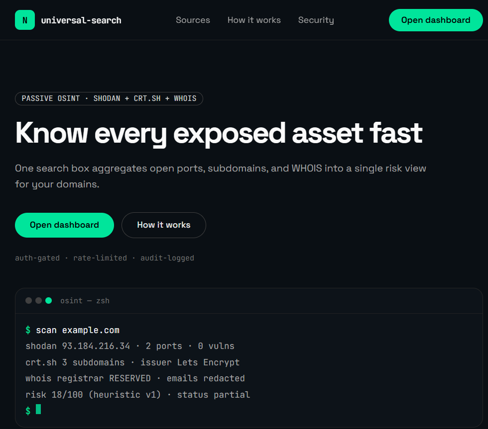
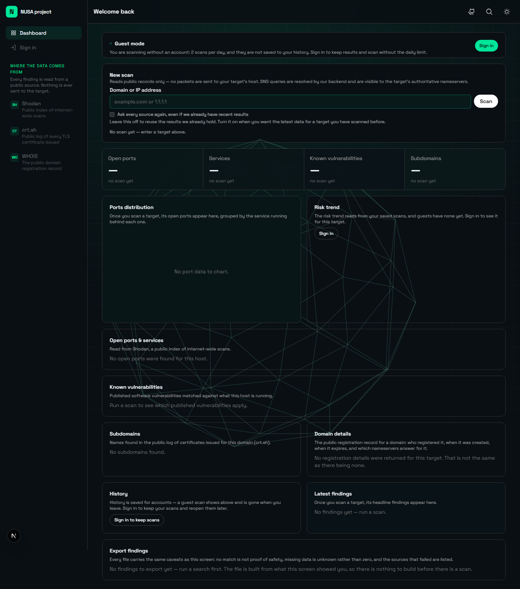

# Network Universal Search Agent

**See what the internet already says about a domain, before you point anything at it.**

Type one domain or public IP. In a few seconds you get a single report: which ports answer and what runs on them, which names sit under the domain in the public certificate log, who registered it and when it expires, what DNS records it publishes, and which known vulnerabilities match the software we found. Every scan ends with a 0 to 100 risk score and is saved, so you can open it again later and compare it with the same domain's last result.




## What one search gives you

- **Ports and software.** What is open, and what software and version answers on each port.
- **Names that are not on any page.** Subdomains that appear in public certificates.
- **Who holds the domain.** Registrar, creation date, expiry date, nameservers.
- **DNS records.** A, AAAA, MX, NS, TXT, CNAME and SOA.
- **Known issues.** CVEs that match the software we found, with severity.
- **A risk score you can argue with.** 0 to 100, with the pieces that made up the number.
- **History and trend.** Each search is kept, so you can reopen it or watch the score move.
- **Findings you can hand over.** Export a report as JSON, Markdown or PDF.

## It tells you what it could not check

If a source is slow or unreachable, the report still arrives and the card says what was not checked. An empty card means "nothing in these public records", not "nothing is there". This tool never sends packets to the target, so it cannot promise a port is closed just because no public record mentions it.

## Try it without an account

- The landing page has a working terminal. Type in it to see what a report looks like.
- `/demo` shows a finished report for three example sites. No account, no backend, clearly labelled as sample data.
- Signed out, you can run 2 real scans a day from the dashboard. Those results are not saved. Sign in for full history.

## Good to know

- Everything here is passive and public. No port scanning, no exploitation, nothing intrusive. DNS lookups do reach the domain's nameservers, so the operator of that domain can see the lookup.
- Limits: 5 scans an hour per account by default, which is the production ceiling because one Shodan key pays for all of them. A deployment can also set a daily cap. Guests get 2 per day per browser, plus a shared daily cap for the whole instance.
- Public targets only. Localhost, private addresses and link-local ranges are refused.
- History, trend and analysis are per account. Nobody else can see your searches.

## Run it locally

You need Node 22.18 or newer, Python 3.11 or newer, Docker and Git.

```powershell
# 1. config and database
Copy-Item frontend\.env.local.example frontend\.env.local
Copy-Item backend\.env.example backend\.env      # add SHODAN_API_KEY and BETTER_AUTH_SECRET (32+ chars)
$env:POSTGRES_PASSWORD = "pick-any-local-password"
docker compose up -d postgres

# 2. backend
cd backend
python -m venv .venv
.\.venv\Scripts\Activate.ps1
pip install -r requirements-dev.txt
alembic upgrade head
uvicorn app.main:app --reload --port 8000

# 3. frontend, in a second terminal
cd frontend
npm install
npm run auth:migrate
npm run dev
```

Then open http://localhost:3000, sign up, and scan `example.com`. On macOS or Linux use `cp` instead of `Copy-Item`. Windows users can run `.\dev.ps1` to start both sides at once.

No valid Shodan key? The scan still completes as a partial report: the Shodan card shows an error badge while the certificate log, WHOIS and DNS cards fill in. That is designed behaviour, not a crash.

## Still stuck or want the details

- Setup, environment variables, OAuth, tests, troubleshooting: [WORKFLOW.md](./WORKFLOW.md)
- How the system is built: [ARCHITECTURE.md](./ARCHITECTURE.md)
- What it was specified to do: [PRD.md](./PRD.md)
- Visual language and copy rules: [DESIGN.md](./DESIGN.md)
- Rules for contributors: [AGENTS.md](./AGENTS.md)
- What shipped and when: [CHANGELOG.md](./CHANGELOG.md)
- What is still open: [TODO.md](./TODO.md)

Built with Next.js and FastAPI, Better Auth for accounts, PostgreSQL for scan history, and a thin capture layer for the public sources it reads.

License: [MIT](./LICENSE).